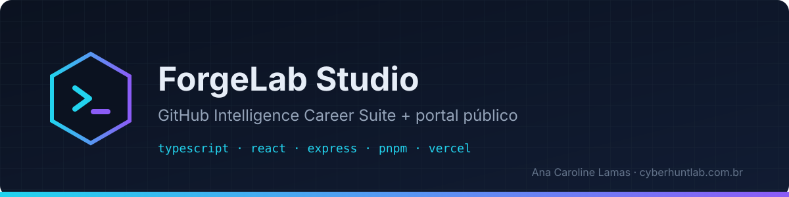

<p align="center"></p>

# ForgeLab Studio — GitHub Intelligence Career Suite e portal público

Monorepo **TypeScript** (pnpm) com a **GitHub Intelligence Career Suite**, uma plataforma que alinha **currículo, portfólio no GitHub e ideias de projetos**, e um **portal público** com área administrativa protegida para deploy no **Vercel**. A suíte une o motor de modernização de perfil no GitHub ao **HACKMIND**, um gerador de ideias para hackathons.

> Cópia do [forgelab-studio](https://github.com/ticarollamas-arch/forgelab-studio), sem o arquivo `vercel-corrigido.json`.

## Recursos

### GitHub Intelligence Career Suite (`artifacts/github-intelligence`)

- **Currículo e perfil profissional**: upload do currículo, extração do perfil e otimização para ATS (`/api/resume/*`).
- **Curadoria de repositórios**: conecta o GitHub, sincroniza repositórios em segundo plano (com pausa e retomada) e classifica cada um por relevância profissional, riscos, privacidade, README e metadados.
- **README do perfil**: análise e proposta de README, aplicada por pull request só com confirmação (`/api/profile-readme/*`).
- **Geração de projetos e ideias**: projetos de carreira, ideias de startup e projetos de hackathon, com prompt de implementação para cada um.
- **HACKMIND**: pesquisa de competições, hipóteses, comitê adversarial, pontuação, plano de MVP e exportação em Markdown.
- **Relatórios**: documentos para download, prompt de portfólio e relatório consolidado.
- **Provedores de IA no backend**: Groq, NVIDIA NIM, Ollama e endpoints compatíveis com a API da OpenAI.
- **Política de segurança**: nada é excluído, nenhuma visibilidade é alterada e nenhum commit é publicado sem confirmação explícita.

### Portal público (`public/` + `api/admin.js`)

- `/`: apresentação dos módulos, fluxo de uso, condições de acesso e garantia.
- `/login`: tela de entrada de usuários (a autenticação de contas ainda precisa ser conectada).
- `/admin/login` e `/admin`: área administrativa sem link público, com sessão em cookie assinado por HMAC-SHA256 (8 h) e comparação em tempo constante.

## Instalação

Requisitos: **Node.js 20+** (recomendado 22+) e **pnpm**.

```bash
git clone https://github.com/ticarollamas-arch/Gitzip-to-dev.git
cd Gitzip-to-dev
pnpm install
cp artifacts/github-intelligence/.env.example artifacts/github-intelligence/.env
```

| Variável | Uso |
|---|---|
| `ADMIN_EMAIL`, `ADMIN_PASSWORD`, `ADMIN_SESSION_SECRET` | Área administrativa do portal (ver `.env.admin.example`) |
| Variáveis em `artifacts/github-intelligence/.env.example` | Token do GitHub, provedores de IA e banco de dados da suíte |

## Como usar

```bash
pnpm run typecheck     # checagem de tipos de todo o workspace
pnpm run build         # build de todos os pacotes
pnpm --filter @workspace/github-intelligence dev   # suíte em modo desenvolvimento
```

Na suíte, comece pelo currículo, depois conecte o GitHub e revise a curadoria antes de aplicar qualquer mudança.

### Deploy do portal no Vercel

O `vercel.json` publica `public/` como site estático e encaminha `/admin` e `/admin/login` para a função `api/admin.js`. Configure as variáveis do administrador e faça um novo deploy. Detalhes em [docs/PORTAL-PUBLICO-E-ADMIN.md](docs/PORTAL-PUBLICO-E-ADMIN.md).

## Estrutura

```
artifacts/github-intelligence/   suíte principal (React/Vite + Express + HACKMIND)
artifacts/api-server/            serviço de API preservado
artifacts/mockup-sandbox/        ambiente de prototipação
lib/                             cliente da API (React), especificação, schemas Zod e banco
public/ + api/admin.js           portal público e administração
```

## Limitações

- O painel administrativo é uma base autenticada: clientes, pagamentos, planos e pedidos ainda precisam ser ligados a um banco e a serviços comerciais.
- Pendências da suíte estão listadas em `artifacts/github-intelligence/IMPLEMENTACAO_PENDENTE.md`.

## Tecnologias

TypeScript · React · Vite · Express · pnpm workspaces · Zod · Node.js crypto · Groq · NVIDIA NIM · Ollama · GitHub API · Vercel

## Licença

Distribuído sob a licença MIT, conforme declarado no `package.json`. Veja [LICENSE](LICENSE).
